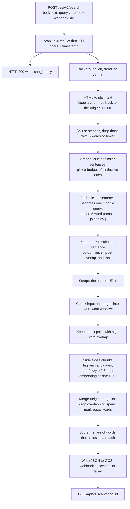

`POST /api/v2/search` returns a `scan_id` immediately. The plagiarism result is computed in the background, stored in GCS, and the caller is told to read it with `GET /api/v1/scan/{scan_id}` after the webhook.

## What the caller actually gets

The POST body is `{ "text": "..." }`. `webhook_url` is required. `verbose` defaults to `true`. Chunk size and score cutoffs are **not** on this API; they are fixed inside `check_for_plagiarism_v2`.

The HTTP response is only `{ "scan_id": "..." }`. The finished document lives at `gs://…/scanned_results/{scan_id}.json`. The webhook body is `{ "submission_id": "<scan_id>", "metaData": { "status": "successful" | "failed" } }`.

`GET /api/v1/scan/{scan_id}` returns `plagiarism_score`, `plagiarism_word_level_score`, `results`, `input`, `links_data`, `scan_id`, and `serp_failed`.

## API and job lifecycle

**Why return before the check finishes?** A scan scrapes the web and embeds thousands of sentences. The handler starts `process_plagiarism_check_background_v2` and returns. The 10-minute HTTP middleware never sees the long work.

**How is** `scan_id` **built?** `md5(text[:100] + time.time())`. Same text submitted twice gets two ids. It is a job id, not a content hash.

**What is the deadline?** `JOB_TIMEOUT_SEC`, default 75 minutes. On timeout or exception the job writes the traceback to GCS and webhooks `failed`. A successful check still webhooks `successful` even if the webhook POST itself fails. Persist and notify get a 30-second grace after the deadline.

**Where do you read the result?** `GET /api/v1/scan/{scan_id}` and `DELETE /api/v1/scan/{scan_id}`. v2 did not add its own scan routes. Fetch rebuilds the payload from `complete_response` in the GCS JSON, which always stores the verbose spans, including uncovered gaps.

**When is** `serp_failed` **true?** When at least one SerpAPI call was made and fewer than half of them returned any organic results.

## Turning messy text into something comparable

**What does “messy web text” mean here?** The body may be HTML, or HTML stuffed inside a JS string like `html = "..."`. `html_to_plain_text_with_mapping` strips `script`, `style`, `meta`, and `noscript`, collapses whitespace, and records which original HTML offset each plain character came from. All matching runs on that plain text. At the end, `start`, `end`, and highlight offsets are mapped back so the client can highlight the original HTML.

**How are sentences split?** On punctuation (including many non-Latin stops) or newlines, via `SENTENCE_SPLIT_REGEX` in `chunking_service_v2.py`. Query selection drops sentences with 5 words or fewer (`TOP_SENTENCE_MIN_SIZE = 5`, and the filter is `>`).

**Why not search every sentence?** SerpAPI calls are the expensive step. v2 embeds the remaining sentences, clusters them, and searches only a diverse, high-signal subset.

**How does clustering work?** Agglomerative clustering on cosine distance, average linkage, threshold `1 - 0.4 = 0.6`. Three or fewer sentences are each their own cluster. If clustering throws, everything becomes one cluster.

**How many sentences get searched?** Tiered by sentence count:

| Sentences | Share | Floor | Cap |
|---|---|---|---|
| ≤ 10 | 90% | 5 | 10 |
| ≤ 25 | 75% | 8 | 18 |
| ≤ 50 | 60% | 12 | 26 |
| ≤ 100 | 45% | 18 | 40 |
| ≤ 200 | 35% | 24 | 60 |
| more | 30% | 32 | 80 |

The cap cannot exceed the sentence count. Budget is spread across clusters by size (at least 1, at most about 60% of that cluster). Leftover slots go to the highest global scores.

**What makes a sentence “important”?** Normalized TF-IDF sum times 10, plus boosts: capitalized words × 0.5, numbers × 0.7, a quote mark × 1.5, `% $ © ®` × 0.5, and × 1.2 when the sentence is 15–35 words. Under 10 words is × 0.7. Openers like “the”, “this”, “it”, “there is” are × 0.85.

**How does a sentence become a Google query?** Words are cut into exact 5-word phrases (`PHRASE_SIZE`). A short tail is replaced by the last 5 words, so the end of the sentence is still searchable. v2 joins every phrase as `"phrase" | "phrase"` in **one** query. v1 split those phrases into several queries of at most 6.

**What SerpAPI settings are used?** From `global.conf`: Google, `num: 40`, `hl: en`, `async: true`, plus `SERP_API_KEY`. Initiate and fetch are capped at 24 in flight (`SERP_CONCURRENCY`). Fetch polls the archive at 1, 2, 4, 8, 16 seconds and then gives up.

## Which pages get scraped

**How is a result ranked?** For each organic hit:

`weight = (domain_weight × 1 + relevance_weight × 2 + rank_weight × 1) / 3`

- Domain: v2 walks the hostname’s labels longest-span first and looks up keys like `.wikipedia.` in `domain_ranks_v2`. Rank 1–3 becomes `(4 - rank) / 3`. Unknown domains are 0. v1 matched the full hostname exactly.
- Relevance: length of `snippet_highlighted_words` divided by the query sentence length.
- Rank: `1 / sqrt(position)`, or 0 if position is missing.

Each query sentence keeps the top 7 (`FILTERED_SERP_RESULT_SIZE`).

**What gets scraped?** The unique `link` values (cached links are ignored unless `use_cached_link` is set, and v2 does not set it). Scrapes go to `http://$DATZOO_CONNECT_ENDPOINT/web-scraper/scrape` with product `PLAGIARISM_CHECKER`, 32 at a time. Failures are dropped; the map is `{url: plain content}`.

**Why doesn’t v2 keep a chunk-to-link map?** v1 only compared a chunk with links that came from that chunk’s queries. v2 scrapes the union of links, chunks every page, and matches chunks globally. A page found via sentence A can still match sentence B.

## Chunking and the three match stages

**How big is a chunk?** 400 words, built from whole sentences. Overlap is `0.05 × 400 = 20` words, walked back over the trailing sentences. A single sentence longer than 400 words becomes its own chunk.

**The parameter is still called** `chunk_trigram_threshold`**. What does it measure?** Word overlap, not character trigrams. Both chunks are lowercased and stripped of punctuation, then scored as:

`LCS(words) / min(len_a, len_b) × gap_factor`

`gap_factor` is 1 when the matched words step forward at the same rate. Each extra word of misalignment costs `0.05`. Default threshold is `0.0`, so almost every non-empty pair qualifies, and each input chunk keeps the best **600** scraped chunks (`top_k_chunks`).

**What is a valid sentence at match time?** More than 5 words, and non-alphanumeric characters at most 80% of the string. v1 used 9 words.

**Stage 1 — character trigrams.** An inverted index maps each 3-character gram of the scraped sentences to sentence ids. Each input sentence keeps the scraped sentences that share the most of its trigrams, capped at **1000** (`top_k_sentences`). This is the candidate generator, not the final score.

**Stage 2 — fuzzy.** `fuzz.ratio` on the cleaned strings, divided by 100. Keep pairs at or above **0.6**.

**Stage 3 — embeddings.** Unique sentences in the surviving pairs are embedded once at `http://$ZOO_CONNECT_ENDPOINT/sentence-embedder/embed` (product `Plagiarism`), 48 at a time. The score is cosine similarity. Keep pairs at or above **0.5**. A missing vector scores 0. The comment in the code says “cross-encoder”; the code is a bi-encoder plus cosine.

**What are** `score` **and** `semantic_score` **on a hit?** `score` is the fuzzy ratio. `semantic_score` is the cosine. Both are returned.

## From hits to a plagiarism score

**How are neighboring hits merged?** The live v2 path calls the **v1** merger. Per source URL, two hits merge when they touch, or when only whitespace sits between them on both the input and the source. The merged scores are a plain average. `merge_sentence_pairs` in `similarity_service_v2.py` (merge if the gap is ≤ 25 characters, weight by length) is imported and not used.

**Two sources claim the same span. Who wins?** `remove_duplicates` sorts by start, then higher fuzzy score. Same start: longer span wins, then higher score. A span fully inside another is dropped. A span that sticks out is clipped to the free part, and the source offsets are scaled by the same fraction. Half-open intervals, so touching spans `[0, 10)` and `[10, 20)` do not overlap.

**What is a highlight?** `difflib.SequenceMatcher` on words. Equal runs are `{highlight: true}`. Replacements and deletions are `{highlight: false}`. Insertions that exist only in the source are not returned. Offsets are in the input, then mapped to HTML.

**What is** `plagiarism_score`**?** Uncovered plain-text ranges are gaps. Score = `(all words − words inside gaps) / all words`, using a whitespace split. No matches means the whole document is one gap and the score is 0. This is coverage, not an average of fuzzy scores. A 10-word exact copy inside a 100-word essay scores about 0.10.

**What is** `plagiarism_word_level_score`**?** On each verbose span, `SequenceMatcher` counts words that are not insert/delete/replace, divided by `max(input words, source words)`. Those ratios are combined by word count. On `GET /scan`, gap rows (score 0, no source) are included, so uncovered words pull this number down too.

**What does** `verbose` **change?** `true` adds `input` and `source` text on each span, plus the zero-score gap spans. `false` returns only the matched spans. The GCS blob used by `GET /scan` always stores the verbose list, so the fetch API does not honor `verbose=false`.

## Limits, failures, and v1 vs v2

**What bounds fan-out?** `EMBED_CONCURRENCY` 48, `SERP_CONCURRENCY` 24, `SCRAPE_CONCURRENCY` 32. Each is an env var, minimum 1, one process-wide semaphore.

**A scrape or embed fails. Does the job fail?** No. That link or sentence is skipped. The job fails on an uncaught exception or the 75-minute deadline.

**Empty scrape for every link?** Chunk matching returns `[]`. Coverage is 0. The webhook is still `successful`.

**Why v2 if v1 already searched the web?**

- One SerpAPI call per selected sentence, instead of several calls of 6 phrases.
- Query sentences come from embedding clusters, not from fixed chunks plus a dissimilarity cutoff.
- Domain weight matches a label pattern, so `en.wikipedia.org` and mirrors can share `.wikipedia.`.
- Pages are compared by chunk similarity, not only against the chunk that retrieved them.
- Match thresholds are code defaults (`0.6` fuzzy, `0.5` cosine, 400-word chunks), not request parameters.

**What would you flag in review?** The chunk matcher’s name still says trigram. The semantic step’s comment says cross-encoder. The length-weighted v2 merger is dead code. `GET /scan` ignores `verbose`. `plagiarism_score` uses the v1 word splitter even on the v2 path.